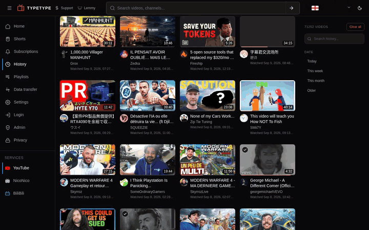
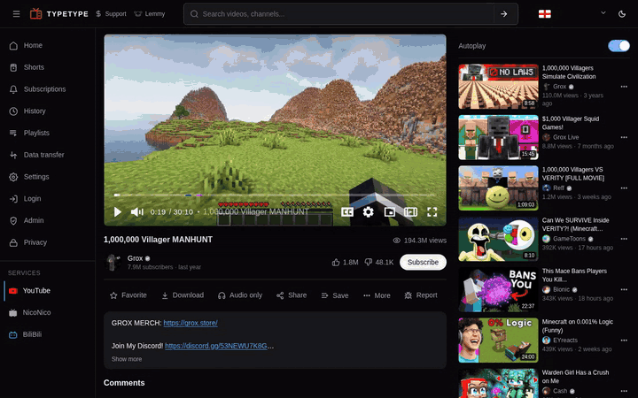
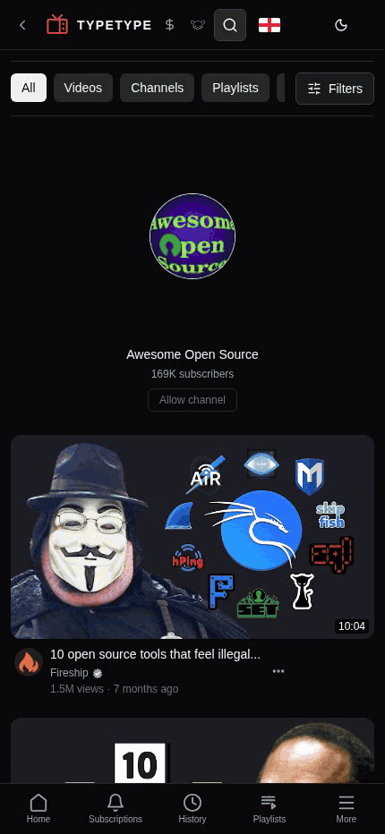

<p align="center">
  
</p>

You want to know the current position of TypeType about AI ? Go check [this](https://github.com/TypeType-Video/TypeType/blob/dev/AI_TRANSPARENCY.md).

[Roadmap](https://roadmap.typetype.video) · [Git mirror](https://git.typetype.video/TypeType-Video)

# TypeType

TypeType is a self-hosted video platform for YouTube, NicoNico, and BiliBili.
Run one private instance, then use it from the responsive web app or the native
Android client. Accounts, subscriptions, history, playlists, favorites, watch
progress, and settings stay on the instance you control.

<p align="center">
  <a href="https://typetype.video/fdroid/"></a>
  <a href="https://github.com/TypeType-Video/TypeType-Android/releases/latest"></a>
</p>

## Install

Docker Engine and Docker Compose v2 are required for the self-hosted stack.

```sh
curl -fsSL https://raw.githubusercontent.com/TypeType-Video/TypeType/main/scripts/install-stack.sh | bash
```

## Web app

The web app runs in a modern browser on desktop and mobile. It provides
multi-service discovery, personal libraries, downloads, administration, and
SABR playback without installing a client.

<p align="center">
  
</p>

### Search across three services

<p align="center">
  
</p>

### Personal library

<p align="center">
  
</p>

### Web playback

<p align="center">
  
</p>

### Mobile web

| Home | Search | Playback |
| --- | --- | --- |
|  |  |  |

<p align="center">
  
</p>

## Native Android app

[TypeType Android](https://github.com/TypeType-Video/TypeType-Android) is the
native client for Android phones and tablets. It connects directly to your
TypeType instance and includes synchronized accounts, subscriptions, history,
playlists, downloads, background audio, Picture in Picture, audio-only playback,
captions, SponsorBlock, comments, and native playback controls.

| Home | Native player | Settings |
| --- | --- | --- |
|  |  |  |

TypeType Android supports Android 6.0 and newer without requiring Google Play
Services. Read the
[Android installation guide](https://github.com/TypeType-Video/TypeType-Android#install)
for F-Droid and signed APK instructions.

## Self-host TypeType

This central repository contains the Docker Compose stack, installer, update
and rollback tools, release coordination, and project issue tracker. The web
and Android clients both connect to the same TypeType instance.

The installer creates `~/typetype-stack`, generates installation-specific secrets, and asks before starting the stack.

The first startup runs one short-lived `typetype-init` task. It creates the
Downloader database, prepares the Garage configuration, and stores the private
YouTube session secrets in named volumes before the application services start.
Compose removes its container automatically after a successful setup.

For an existing installation, update the Compose files and run:

```sh
./scripts/run-stack-init.sh
docker compose up -d --remove-orphans --wait
```

The migration keeps the existing `postgres_data`, `typetype_secrets`, and
Garage volumes. Do not use `docker compose down -v` during an update: that
would delete the account database, generated secrets, and stored download
artifacts.

- [Quick start](https://typetype-video.github.io/Docs-TypeType/self-hosting/quick-start)
- [Manual Docker Compose setup](https://typetype-video.github.io/Docs-TypeType/self-hosting/docker-compose#manual-setup)
- [Configuration](https://typetype-video.github.io/Docs-TypeType/self-hosting/configuration)

### Optional: recommender (experimental)

The recommender is a separate service that can build the home page with one of
several algorithms each user picks and tunes. It is optional: a stack without it
behaves exactly as before and shows no option anywhere.

What it needs:

- about 1.2 GB of memory at rest (the container is capped by `RECOMMENDER_MEMORY_LIMIT`, 2 GB by default);
- about 1 GB of disk for its image and its language model, downloaded once on first start into the `recommender_models` volume (the first start needs internet access and takes a few minutes);
- PostgreSQL with the `pgvector` extension: the overlay switches the `postgres` service to an image that ships it, on the same data volume;
- its own database (`typetype_recommender`) and a shared secret, both created by `typetype-init`.

Add it with the installer, which asks, or takes `--recommender`:

```sh
curl -fsSL https://raw.githubusercontent.com/TypeType-Video/TypeType/main/scripts/install-stack.sh | bash -s -- --recommender
```

Or by hand on an existing stack:

```sh
COMPOSE_RECOMMENDER_FILE=docker-compose.recommender.yml ./scripts/run-stack-init.sh
docker compose -f docker-compose.yml -f docker-compose.recommender.yml up -d --wait
```

The installer switches it on (`RECOMMENDER_ENABLED=true`); by hand, switch it on in
the admin console. Each user still chooses to turn it on for themselves.

Remove it:

Set `RECOMMENDER_ENABLED=false` in `.env` before removing the overlay, or the
installer will enable it again on a future update. For a beta stack, use
`docker-compose.dev.yml` instead of `docker-compose.yml`.

```sh
docker compose -f docker-compose.yml up -d --remove-orphans --wait
```

The home page goes back to the standard one and the option disappears. User
choices and opinions stay in the database, and the `recommender_models` volume
and the `typetype_recommender` database can be deleted by hand.

All its settings (`RECOMMENDER_*`, `TYPETYPE_RECOMMENDER_IMAGE`,
`TYPETYPE_POSTGRES_VECTOR_IMAGE`) are listed in `.env.example`.

### Maintain your instance

- [User guide](https://typetype-video.github.io/Docs-TypeType/guide/)
- [Update guide](https://typetype-video.github.io/Docs-TypeType/self-hosting/maintenance)
- [Rollback guide](https://typetype-video.github.io/Docs-TypeType/self-hosting/rollback)
- [Release notes](https://typetype.video/releases)
- [Report a bug or request a feature](https://github.com/TypeType-Video/TypeType/issues)

## Translations

<a href="https://translate.typetype.video/engage/typetype/">
    
</a>

The [Weblate](https://translate.typetype.video/projects/typetype/web/) platform is the preferred method of contributing translations to the TypeType web interface.

Read the [localization guide](https://github.com/TypeType-Video/TypeType-Frontend/blob/dev/LOCALIZATION.md) for the catalog and contribution workflow.

## What TypeType includes

- Responsive web and native Android clients for YouTube, NicoNico, and BiliBili
- Accounts, subscriptions, history, playlists, favorites, and watch progress
- MSE and SABR playback with quality, audio-track, subtitle, and recovery controls
- Video and audio downloads with local or S3-compatible storage
- SponsorBlock, DeArrow, content blocking, imports, OIDC, and instance administration
- No TypeType telemetry; the instance operator controls the deployment and its data

## Thanks to sponsors

### Recurring sponsor

<p>
  <a href="https://github.com/Toastienergy" title="@Toastienergy"></a>
  <a href="https://github.com/crichemond" title="@crichemond"></a>
</p>

Thank you to [@Toastienergy](https://github.com/Toastienergy) and
[@crichemond](https://github.com/crichemond) for supporting TypeType through
recurring GitHub Sponsors contributions. It helps me cover the infrastructure
and spend more time improving the project.

If you want to support TypeType financially, you can do so through
[GitHub Sponsors](https://github.com/sponsors/Priveetee).

## Star history

<a href="https://star-history.dera.page/#TypeType-Video/TypeType">
  <picture>
    <source media="(prefers-color-scheme: dark)" srcset="https://star-history.dera.page/svg?repos=TypeType-Video/TypeType&theme=dark">
    <source media="(prefers-color-scheme: light)" srcset="https://star-history.dera.page/svg?repos=TypeType-Video/TypeType">
    
  </picture>
</a>

The chart is rendered by [SimRepo](https://github.com/Mubelotix/SimRepo), a
token-free GitHub star history service.

## For developers

Each component has its own repository, tests, release cycle, and license. Pull requests belong in the repository that owns the changed code. Bug reports and feature requests stay in the central issue tracker.

| Repository | Responsibility | License |
| --- | --- | --- |
| [TypeType](https://github.com/TypeType-Video/TypeType) | Stack, installer, releases, coordination, and issues | MIT |
| [TypeType-Android](https://github.com/TypeType-Video/TypeType-Android) | Native Android client | GPL-3.0 |
| [TypeType-Frontend](https://github.com/TypeType-Video/TypeType-Frontend) | React web client | MIT |
| [TypeType-Server](https://github.com/TypeType-Video/TypeType-Server) | Kotlin API, extraction, and user data | GPL-3.0 |
| [TypeType-Player](https://github.com/TypeType-Video/TypeType-Player) | Browser MSE and SABR playback package | MIT |
| [TypeType-Token](https://github.com/TypeType-Video/TypeType-Token) | YouTube token, decoder, and session service | MIT |
| [TypeType-Downloader](https://github.com/TypeType-Video/TypeType-Downloader) | Download jobs, muxing, and artifacts | GPL-3.0-or-later |
| [Docs-TypeType](https://github.com/TypeType-Video/Docs-TypeType) | User and self-hosting documentation | MIT |

Development changes target each component's `dev` branch. `main` represents the stable release line.

Clone the central stack and all public components with:

```sh
git clone --recurse-submodules https://github.com/TypeType-Video/TypeType.git
```

Read [CONTRIBUTING.md](CONTRIBUTING.md) before opening a pull request.

## Privacy and disclaimer

TypeType is designed to provide a private, self-hosted way to use supported media services. The project does not add telemetry or collect usage data. Instance operators control their own accounts, logs, storage, and network configuration.

TypeType is not affiliated with, funded, authorized, endorsed by, or associated with YouTube, Google LLC, NicoNico, BiliBili, or their affiliates. Trademarks, service marks, trade names, and other intellectual property belong to their respective owners.

TypeType is open source software built for learning and research purposes.

## License

The orchestration files in this repository are licensed under the [MIT License](LICENSE). Each component keeps the license shown in the repository table.
